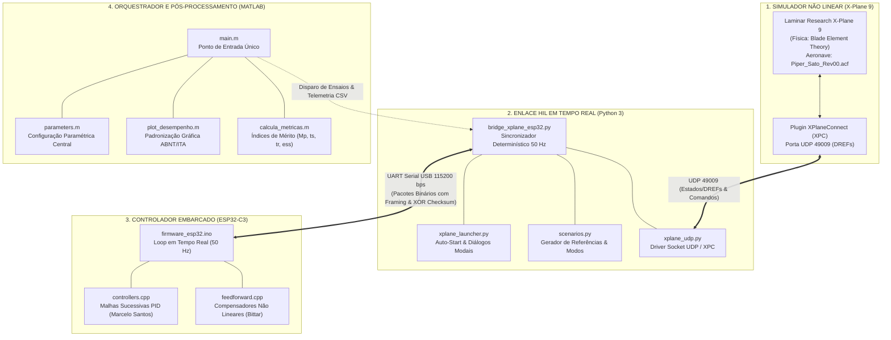

# EA-291: Banco de Ensaio Hardware-in-the-Loop (HIL) para Piloto Automático de VANT

> **Instituto Tecnológico de Aeronáutica (ITA)**  
> **Programa de Pós-Graduação em Engenharia Aeronáutica e Mecânica (PG-EAM)**  
> **Disciplina:** EA-291 — Pilotos Automáticos para Veículos Aéreos Não Tripulados  
> **Aeronave Alvo:** Piper PA-18 Super Cub (Escala 1/6) — Modelo Sato (2021) / Marcelo Santos (2018)  
> **Hardware de Controle:** Espressif ESP32-C3 (RISC-V @ 160 MHz)  
> **Simulador Aerodinâmico:** Laminar Research X-Plane 9 (Blade Element Theory)  

---

## 1. Objetivo do Projeto

O objetivo deste projeto é o desenvolvimento, validação e ensaio experimental de uma arquitetura **Hardware-in-the-Loop (HIL)** em tempo real para o piloto automático de um Veículo Aéreo Não Tripulado (VANT). O sistema integra:

1. **Execução Determinística Embarcada:** O controlador de voo opera embarcado no microcontrolador ESP32-C3 a uma frequência estrita de **$50\text{ Hz}$** ($\Delta t = 20\text{ ms}$), desacoplado do sistema operacional do computador hospedeiro.
2. **Avaliação dos Compensadores de Feedforward (Adriano Bittar, 2014):** Comparação experimental da resposta dinâmica com e sem os termos de antecipação (Feedforward de arfagem em curva coordenada, aceleração longitudinal e cancelamento de guinada adversa).
3. **Excitação e Análise dos Modos Fundamentais de Voo (Nelson, 1998):**
   * **Modos Longitudinais:** Modo de Período Curto (*Short Period*) e Modo Fugóide (*Phugoid*).
   * **Modos Látero-Direcionais:** Modo de Rolagem (*Rolling Mode*), Modo *Dutch Roll* e Modo Espiral (*Spiral Mode*).
4. **Ambiente Integrado e Paramétrico no MATLAB:** Centralização de todas as condições de equilíbrio (*trim*), ganhos de controle e perfis de manobra em script paramétrico ([`parameters.m`](scripts_matlab/parameters.m)) e orquestração direta via [`main.m`](scripts_matlab/main.m).
5. **Automação Completa do Simulador (*Turn-Key*):** Inicialização automática em segundo plano do X-Plane 9 pelo orquestrador, tratamento de caixas de diálogo modais e sincronização por *handshake* UDP.

---

## 2. Arquitetura do Sistema

A bancada HIL opera em malha fechada distribuída em quatro camadas integradas:



### Detalhamento das Camadas

1. **X-Plane 9 (Plataforma de Simulação):**
   * Executa o modelo do *Piper PA-18 Super Cub* (1/6) com geometria, momentos de inércia e superfícies sustentadoras reais.
   * Comunica-se com o computador via plugin C++ *XPlaneConnect* na porta UDP `49009`.
2. **Ponte Python HIL ([`bridge_hil/`](bridge_hil/)):**
   * Mantém o ciclo determinístico de 50 Hz ($\Delta t = 20\text{ ms}$).
   * Injeta as referências do cenário de ensaio selecionado (`scenarios.py`).
   * Empacota estados do simulador e envia para o microcontrolador via UART USB.
   * Recebe as deflexões dos atuadores calculadas pelo ESP32 e as escreve no X-Plane (`sim/flightmodel/controls/`).
3. **Firmware ESP32 ([`firmware_esp32/`](firmware_esp32/)):**
   * Implementado em C++ para microcontrolador Espressif ESP32-C3.
   * Malhas de controle PID clássicas por realimentação de estados (Marcelo Santos, 2018).
   * Compensadores de antecipação chaveáveis por máscara de bits (Adriano Bittar, 2014).
4. **Orquestrador MATLAB ([`scripts_matlab/`](scripts_matlab/)):**
   * Dispara o ensaio diretamente a partir do script [`main.m`](scripts_matlab/main.m).
   * Lê a telemetria gerada em formato CSV em [`logs/`](logs/).
   * Extrai métricas de regime transitório e permanente (Sobressinal $M_p$, Tempo de Subida $t_r$, Tempo de Acomodação $t_s$ e Erro Permanente $e_{ss}$).
   * Gera os gráficos padronizados em [`figures/`](figures/).

---

## 3. Protocolo de Comunicação Serial (Downlink & Uplink)

A comunicação entre a ponte Python e o microcontrolador ESP32 é binária, com delimitação por marcadores de sincronismo (*Framing*) e validação estrita por *checksum* XOR.

### Downlink: Host (PC) $\rightarrow$ Microcontrolador (ESP32)
* **Tamanho:** $52\text{ bytes}$
* **Cabeçalho:** `0xAA 0x55` (2 bytes)
* **Carga Útil:** 15 variáveis em ponto flutuante de precisão simples `float32` ($15 \times 4 = 60$ bytes normalizados) + 1 byte de flags de ativação de Feedforward:
  $$\mathbf{x}_{\text{down}} = [h_{\text{ref}}, V_{T,\text{ref}}, \theta_{\text{ref}}, \phi_{\text{ref}}, h, V_T, u, v, w, p, q, r, \phi, \theta, \psi, \text{flags}_{\text{ff}}]$$
* **Validação:** Checksum XOR sobre todos os bytes do payload.

### Uplink: Microcontrolador (ESP32) $\rightarrow$ Host (PC)
* **Tamanho:** $28\text{ bytes}$
* **Cabeçalho:** `0x55 0xAA` (2 bytes)
* **Carga Útil:** Comandos de superfície e empuxo calculados pelo piloto automático:
  * $\delta_e$: Deflexão do Profundor normalizada $[-1.0, +1.0]$
  * $\delta_T$: Comando da Manete de Potência $[0.0, 1.0]$
  * $\delta_a$: Deflexão de Ailerons normalizada $[-1.0, +1.0]$
  * $\delta_r$: Deflexão do Leme de Direção normalizada $[-1.0, +1.0]$
  * Variáveis de depuração e tempo de execução interno ($\Delta t_{\text{proc}}$ em microsegundos).
* **Validação:** Checksum XOR sobre os bytes do payload.

---

## 4. Estratégias de Controle

### 4.1. Piloto Automático Clássico por Realimentação (Marcelo Santos, 2018)

A malha longitudinal baseia-se em controle por fechamento de malhas sucessivas:
* **Amortecimento de Arfagem:** Realimentação da taxa angular de arfagem $q$ para o profundor $\delta_e$.
* **Atitude Longitudinal ($\theta$):** Controle proporcional com cancelamento de perturbação.
* **Malha Externa de Altitude ($h$):** Geração de referência de arfagem $\theta_{\text{ref}}$ a partir do erro de altitude $e_h = h_{\text{ref}} - h$.
* **Malha de Velocidade Aerodinâmica ($V_T$):** Controlador PI atuando na manete de potência $\delta_T$.

A malha látero-direcional implementa:
* **Amortecedor de Guinada (*Yaw Damper*):** Realimentação da taxa de guinada $r$ para o leme $\delta_r$, amortecendo o modo *Dutch Roll*.
* **Controle de Rolamento ($\phi$):** Fechamento da taxa de rolamento $p$ e ângulo de rolamento $\phi$ para os ailerons $\delta_a$.

### 4.2. Compensadores Feedforward de Adriano Bittar (2014)

Para mitigar os acoplamentos não lineares intrínsecos à dinâmica de voo, três compensadores de antecipação foram implementados:

1. **Compensador do Profundor em Curva Coordenada:**  
   Em curvas bancadas ($\phi \neq 0$), a componente vertical da sustentação é reduzida por $\cos\phi$. O compensador antecipa a perda de sustentação:
   $$\Delta \delta_{e,\text{ff}} = K_{\text{elev}} \cdot \left(\frac{1}{\cos\phi} - 1\right)$$

2. **Compensador da Manete de Potência em Subida:**  
   Antecipa a necessidade de potência proporcional à taxa de variação da referência de altitude ou aceleração:
   $$\Delta \delta_{T,\text{ff}} = K_{\text{thr}} \cdot \sin(\theta_{\text{ref}} - \theta_0)$$

3. **Compensador de Cancelamento de Guinada Adversa (*Adverse Yaw Cancellation*):**  
   Ao defletir os ailerons, a asa externa sofre maior arrasto induzido, tendendo a guinar a aeronave em sentido contrário à curva. O compensador acopla o leme à taxa de rolamento:
   $$\Delta \delta_{r,\text{ff}} = K_{\text{rud}} \cdot \delta_a$$

---

## 5. Modos Dinâmicos de Voo (Nelson, 1998)

O sistema conta com geradores analíticos de estímulo em [`bridge_hil/scenarios.py`](bridge_hil/scenarios.py) para excitar e evidenciar isoladamente os 5 modos fundamentais da dinâmica de voo:

```
                      +-----------------------------------+
                      |      DINÂMICA DE VOO DO VANT      |
                      +-----------------+-----------------+
                                        |
                 +----------------------+----------------------+
                 |                                             |
   +-------------v-------------+                 +-------------v-------------+
   |    MODOS LONGITUDINAIS    |                 |  MODOS LÁTERO-DIRECIONAIS |
   |         (Aula 6)          |                 |          (Aula 7)         |
   +-------------+-------------+                 +-------------+-------------+
                 |                                             |
         +-------+-------+                             +-------+-------+
         |               |                             |       |       |
   +-----v-----+   +-----v-----+                 +-----v-----+ | +-----v-----+
   |  Período  |   |  Fugóide  |                 |  Rolagem  | | |  Espiral  |
   |   Curto   |   | (Phugoid) |                 | (Rolling) | | |  (Spiral) |
   +-----------+   +-----------+                 +-----------+ | +-----------+
                                                               |
                                                         +-----v-----+
                                                         |   Dutch   |
                                                         |   Roll    |
                                                         +-----------+
```

| Categoria | Cenário no MATLAB | Duração | Descrição Física e Estímulo Injetado |
| :--- | :--- | :--- | :--- |
| **Modo Longitudinal** | `'periodo_curto'` | $15\text{ s}$ | **Período Curto (*Short Period*):** Dinâmica rápida de arfagem e ângulo de ataque com $\Delta u \approx 0$. Injeta um *doublet* de arfagem $\pm 4^\circ$ aos $t = 4\text{ s}$ para estimativa de $\omega_{n,\text{sp}}$ e $\zeta_{\text{sp}}$. |
| **Modo Longitudinal** | `'fugoide'` | $45\text{ s}$ | **Fugóide (*Phugoid*):** Oscilação de período longo e baixo amortecimento (troca contínua de energia cinética e potencial com $\Delta \alpha \approx 0$). Injeta degrau de altitude $+20\text{ m}$ aos $t = 5\text{ s}$. |
| **Modo Látero-Direcional** | `'modo_rolagem'` | $20\text{ s}$ | **Modo de Rolagem (*Rolling Mode*):** Modo exponencial rápido e altamente convergente governando a taxa angular $p(t)$. Injeta degrau de rolamento $\phi_{\text{ref}} = +20^\circ$ aos $t = 5\text{ s}$ para cálculo da constante de tempo $\tau_r$. |
| **Modo Látero-Direcional** | `'dutch_roll'` | $25\text{ s}$ | **Dutch Roll:** Movimento oscilatório acoplado de guinada e rolamento (*yaw-roll coupling*). Injeta um *doublet* látero-direcional de $\pm 15^\circ$ aos $t = 4\text{ s}$ para teste do *Yaw Damper*. |
| **Modo Látero-Direcional** | `'modo_espiral'` | $35\text{ s}$ | **Modo Espiral (*Spiral Mode*):** Modo lento não-oscilatório que descreve a evolução acoplada da proa ($\psi$) e rolamento ($\phi$). Injeta perturbação com resíduo de $+2^\circ$ aos $t = 5\text{ s}$. |
| **Manobra Operacional** | `'degrau_altitude'` | $25\text{ s}$ | **Degrau de Altitude:** Resposta ao degrau puro na malha longitudinal de $+20\text{ m}$ aos $t = 5\text{ s}$ ($h_{\text{ref}} = 120\text{ m}$), mantendo velocidade e asas niveladas. |
| **Manobra Operacional** | `'degrau_velocidade'` | $25\text{ s}$ | **Degrau de Velocidade:** Resposta ao degrau puro de $+3\text{ m/s}$ aos $t = 5\text{ s}$ ($V_{T,\text{ref}} = 18\text{ m/s}$), avaliando resposta do autothrottle e variação de empuxo. |
| **Manobra Operacional** | `'degrau_rolamento'` | $25\text{ s}$ | **Degrau de Rolamento:** Manobra de inclinação de asa pura $\phi_{\text{ref}} = +20^\circ$ aos $t = 5\text{ s}$ sem alteração nas referências longitudinais. |
| **Manobra Operacional** | `'curva_coordenada'` | $25\text{ s}$ | **Curva Coordenada com Subida:** Manobra composta com inclinação de $\phi_{\text{ref}} = 25^\circ$ entre $5\text{ s} \le t < 20\text{ s}$ e rampa/degrau de subida $+15\text{ m}$ aos $t = 12\text{ s}$. |
| **Bateria Comparativa** | `'comparativo_ff'` | $25\text{ s}$ | **Ensaio Duplo Feedforward ON vs. OFF:** Executa automaticamente a bateria sequencial comparativa para evidenciar os ganhos dos compensadores de Adriano Bittar. |
| **Equilíbrio / Trim** | `'trim_livre'` | $25\text{ s}$ | **Voo Estacionário Trimado:** Voo reto nivelado com todas as referências no ponto de equilíbrio ($H_0 = 100\text{ m}, V_{T0} = 15\text{ m/s}, \theta_0 = -6.97^\circ, \phi_0 = 0^\circ$). |

---

## 6. Estrutura do Repositório

```text
Trabalho2/
├── .gitignore                      # Regras para ignorar X-Plane, ISOs, logs e binários
├── README.md                       # Documentação técnica completa do projeto
├── bridge_hil/                     # Enlace de comunicação em tempo real (Python)
│   ├── bridge_xplane_esp32.py      # Script principal do loop determinístico HIL (50 Hz)
│   ├── protocol_serial.py          # Serialização binária, empacotamento e checksum
│   ├── scenarios.py                # Gerador analítico de trajetórias e modos de voo
│   ├── xpc.py                      # Cliente do protocolo XPlaneConnect
│   ├── xplane_launcher.py          # Gerenciador de inicialização do X-Plane 9 e diálogos
│   └── xplane_udp.py               # Driver UDP (XPC porta 49009 / Nativo 49010)
├── figures/                        # Gráficos gerados automaticamente em alta resolução
│   ├── fig1_desempenho_longitudinal.png
│   ├── fig2_desempenho_laterodirecional.png
│   └── fig3_comparativo_feedforward_bittar.png
├── firmware_esp32/                 # Código-fonte C++ embarcado no ESP32-C3
│   ├── firmware_esp32.ino          # Loop principal de controle e interrupções
│   ├── controllers.cpp / .h        # Algoritmos PID e malhas sucessivas
│   ├── feedforward.cpp / .h        # Compensadores não lineares de Adriano Bittar
│   └── protocol.h                  # Estruturas dos pacotes binários
├── logs/                           # Telemetrias de ensaios salvas em formato CSV
│   └── .gitkeep
└── scripts_matlab/                 # Orquestrador, parâmetros e pós-processamento
    ├── calcula_metricas.m          # Cálculo de Mp, ts, tr, ess
    ├── main.m                      # Ponto de entrada único do sistema
    ├── parameters.m                # Central de parâmetros e condições de equilíbrio
    └── plot_desempenho.m           # Renderização gráfica com padronização visual
```

---

## 7. Como Executar

### 7.1. Pré-Requisitos
* **MATLAB:** Versão R2024b (ou superior) com suporte a scripts `.m`.
* **Python:** Versão 3.10+ com bibliotecas padrão (`socket`, `struct`, `ctypes`, `subprocess`) e `pyserial` instalado:
  ```bash
  pip install pyserial
  ```
* **Hardware:** Microcontrolador ESP32-C3 gravado com o firmware da pasta `firmware_esp32/` e conectado via cabo USB à porta `COM5` (ou configurada em `parameters.m`).
* **Simulador:** X-Plane 9 instalado (com a aeronave `Piper_Sato_Rev00.acf` e o plugin *XPlaneConnect* ativo).

### 7.2. Execução Direta no MATLAB
Basta abrir o MATLAB, navegar para a pasta de scripts e chamar `main`:

```matlab
cd('scripts_matlab');

% Executa o cenário padrão (Comparativo Feedforward ON vs OFF):
main;
```

### 7.3. Simulação Paramétrica
Você pode alterar os parâmetros diretamente no arquivo [`parameters.m`](scripts_matlab/parameters.m) ou definir variáveis antes de executar:

```matlab
% Ensaio do Modo de Período Curto (15 segundos)
cenario = 'periodo_curto'; main;

% Ensaio do Modo de Rolagem (20 segundos)
cenario = 'modo_rolagem'; main;

% Ensaio do Modo Dutch Roll (25 segundos)
cenario = 'dutch_roll'; main;

% Ensaio sem simulador/hardware externo (Modo Dry-Run para testes rápidos)
dry_run = true; cenario = 'fugoide'; main;
```

---

## 8. Referências Bibliográficas

1. **BITTAR, Adriano.** *Controle de Voo e Guiamento de Veículos Aéreos Não Tripulados com Aplicações em Manobras Coordenadas*. Tese de Doutorado em Engenharia Eletrônica e Computação, Instituto Tecnológico de Aeronáutica (ITA), São José dos Campos, 2014.
2. **SANTOS, Marcelo Henrique.** *Desenvolvimento e Implementação em Hardware-in-the-Loop de Piloto Automático para Aeronave Remotamente Pilotada*. Dissertação de Mestrado em Engenharia Aeronáutica e Mecânica, Instituto Tecnológico de Aeronáutica (ITA), São José dos Campos, 2018.
3. **NELSON, Robert C.** *Flight Stability and Automatic Control*. 2nd ed. Boston: WCB/McGraw-Hill, 1998.
4. **STEVENS, Brian L.; LEWIS, Frank L.; JOHNSON, Eric N.** *Aircraft Control and Simulation: Dynamics, Controls Design, and Autonomous Systems*. 3rd ed. Hoboken: John Wiley & Sons, 2015.
5. **SATO, et al.** *Identificação de Parâmetros Aerodinâmicos e Estabilidade Dinâmica do Piper Super Cub 1/6*. Relatório de Projeto de Graduação/Pós-Graduação, ITA, 2021.
6. **ITA - PG-EAM.** *Notas de Aula e Material Didático da Disciplina EA-291: Pilotos Automáticos para Veículos Aéreos Não Tripulados*. Instituto Tecnológico de Aeronáutica (ITA), São José dos Campos, 2026.

---

*Desenvolvido no âmbito das atividades acadêmicas do Instituto Tecnológico de Aeronáutica (ITA).*
